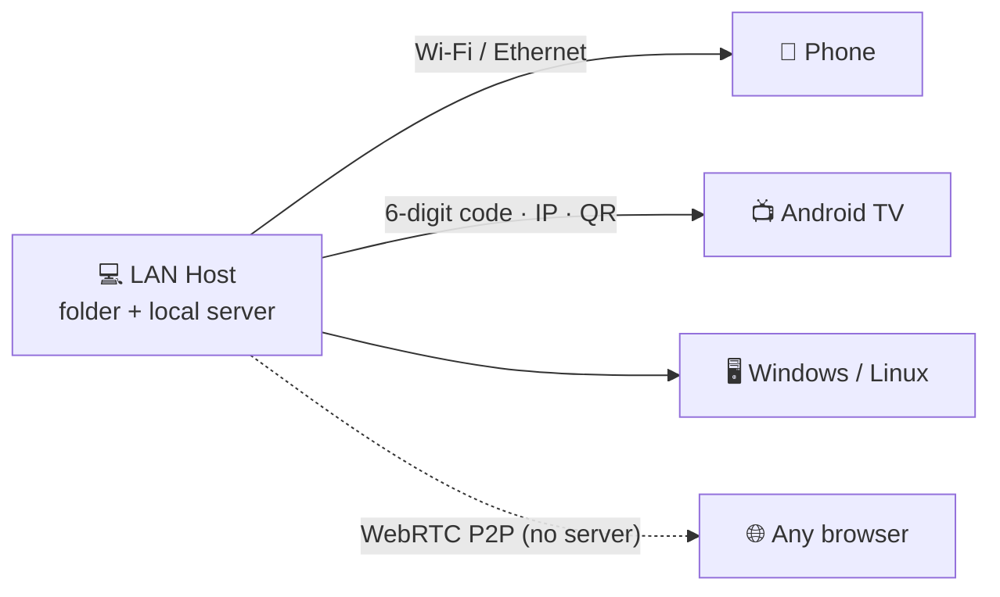

<div align="center">


# LAN Viewer & LAN Host

**Share a folder on one device. Browse, preview and stream it on every other screen: phone, TV, laptop.**
No cloud. No accounts. Your files never leave your network.

[](https://github.com/OWNER/REPO/releases)
[](https://github.com/OWNER/REPO/actions)
[](#license)


[Download](#-download) · [Quick start](#-quick-start) · [Features](#-features) · [Build from source](#-build-from-source) · [Signing](#-signing-the-android-apk)

</div>

---

## ✨ Overview

The project is two small apps that work together:

| | **LAN Host** | **LAN Viewer** (LAN Hub) |
|---|---|---|
| **Role** | Serves a folder from your computer | Browses and plays what the host shares |
| **Runs on** | Desktop (or any browser tab for P2P) | Windows · Linux · Android phone · Android TV |
| **Entry** | `host-index.html` | `viewer.html` / `index.html` |
| **Connect with** | Shows a 6-digit code, an IP link and a QR | Type the code, or enter IP and port |

It also works with **any plain `python -m http.server`** folder, so the host app is optional.



---

## 🚀 Features

### LAN Viewer
- 📁 **File browser** with breadcrumbs, folder navigation, instant search and type filters (Video, Images, Audio, Documents)
- 🎬 **Built-in preview** for video, audio, images, PDF, Word (`.docx`), Markdown, text and source code, with rendered/source toggle and previous/next
- 🎧 **Mini player** that keeps audio playing while you keep browsing
- 📺 **TV mode**: larger UI and a focus ring built for D-pad remotes
- 🤖 **AI assistant** that can explain the open file or your folder, or help with network troubleshooting. Bring your own key for Google Gemini, Groq or OpenRouter
- 🎨 **Three themes**: Dark, Light and Velvet
- 🔒 API keys stay in your device's local storage and go only to the provider you pick

### LAN Host
- 🗂️ **Drag and drop** a folder, pick files, or host a path directly
- 🔢 **Quick code**: a 6-digit code so viewers find the host without typing an IP
- 🔗 **Direct link + QR code** generated on the fly, with auto-detected local IPs
- 📊 **Live traffic monitor**: connected devices, active streams, bandwidth and a colour-coded request log
- ⏩ **HTTP range requests**, so seeking in large videos is instant
- 🌍 **Direct P2P streaming** over WebRTC (via PeerJS) for when there is no desktop server
- 🖥️ **Terminal fallback** with a ready-to-copy command for macOS, Linux and Windows

---

## 📦 Download

Grab the latest build from the **[Releases](https://github.com/OWNER/REPO/releases)** page:

| Platform | File |
|---|---|
| Windows | `lan-viewer-<version>-win-x64.exe` |
| Linux | `.deb` or `.AppImage` |
| Android phone **and** Android TV | `lan-viewer-<version>-android.apk` |

> **Android TV install tip:** enable *Install unknown apps* for your file manager or the Downloader app, then open the APK.

---

## ⚡ Quick start

**1. Host a folder** (on the computer that has the files)

```bash
# Option A: LAN Host app: choose a folder, press "Start hosting"
# Option B: any machine with Python
python -m http.server 8000
```

**2. Connect from a viewer**

1. Open **LAN Viewer** on your phone, TV or laptop.
2. Tap the **Connect** chip in the top bar.
3. Enter the **6-digit code** shown on the host, or choose **IP & port** (e.g. `192.168.1.20` / `8000`).
4. Browse, search and play.

> **Can't connect?** Both devices must be on the same network. Check your firewall, and use the in-app **AI assistant** (*Can't connect* chip) for step-by-step help.

---

## 🛠️ Build from source

**Requirements:** Node.js 20+, and JDK 17 + Android SDK for the APK.

```bash
git clone https://github.com/OWNER/REPO.git
cd REPO
npm ci

# Desktop
npm start                # run the Electron app
npm run dist:win         # Windows installer (.exe)
npm run dist:linux       # .deb + .AppImage

# Android (phone + TV, one APK)
npm run android:debug    # copies viewer.html → www/, syncs Capacitor, builds debug APK
```

Output APK: `android/app/build/outputs/apk/debug/app-debug.apk`

---

## 🔏 Signing the Android APK

<details>
<summary><b>Android Studio</b></summary>

Open the `android/` folder, then **Build → Generate Signed App Bundle / APK → APK**, create or choose a keystore, select `release` and finish.
</details>

<details>
<summary><b>Command line</b></summary>

```bash
./scripts/generate-keystore.sh      # creates android/keystore/lan-viewer.jks + keystore.properties
cd android && ./gradlew assembleRelease
```
</details>

<details>
<summary><b>GitHub Actions (automatic)</b></summary>

Add these repository secrets and the workflow produces a signed release APK. Without them it builds a debug APK.

| Secret | Value |
|---|---|
| `ANDROID_KEYSTORE_BASE64` | `base64 -w0 android/keystore/lan-viewer.jks` |
| `ANDROID_KEYSTORE_PASSWORD` | keystore password |
| `ANDROID_KEY_ALIAS` | e.g. `lanviewer` |
| `ANDROID_KEY_PASSWORD` | key password |
</details>

> ⚠️ Back up your `.jks` and its password. Losing them means you can never ship an update that installs over the old version. Never commit them (they are git-ignored).

---

## 🚢 Releasing

Push a version tag and CI builds every platform and publishes a GitHub Release:

```bash
git tag v1.0.1 && git push origin v1.0.1
```

The workflow can also be started manually from the **Actions** tab, where you can choose which targets to build.

---

## 🗂️ Project structure

```
.
├── viewer.html              # LAN Viewer UI (shared by Electron + Android)
├── main.js                  # Electron entry point
├── scripts/
│   ├── build-web.js         # viewer.html → www/index.html for Capacitor
│   └── generate-keystore.sh # one-step signing key creation
├── android/                 # Capacitor Android project (phone + TV)
├── build/icon.png           # app icon
└── .github/workflows/
    └── release.yml          # Windows · Linux · Android CI + release
```

---

## 🧰 Tech stack

**UI:** vanilla HTML/CSS/JS, Material Symbols, Outfit font · **Desktop:** Electron + electron-builder · **Mobile/TV:** Capacitor 6 on Android · **P2P:** PeerJS / WebRTC · **CI:** GitHub Actions

---

## 🔐 Privacy

- Files are served only while a session is active and are shared only on your local network (or directly peer-to-peer).
- There is no account, no analytics and no cloud storage.
- The AI assistant is optional. When used, requests go only to the provider you configure, with your own key.

---

## 🤝 Contributing

Issues and pull requests are welcome. Please open an issue first for larger changes.

## 📄 License

Released under the [MIT License](LICENSE).

<div align="center">

<sub>Built for the couch, the desk and everything in between. 🛋️</sub>

</div>
